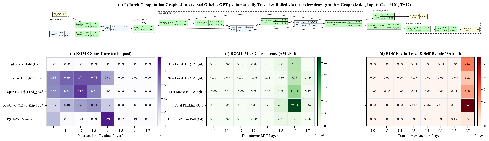
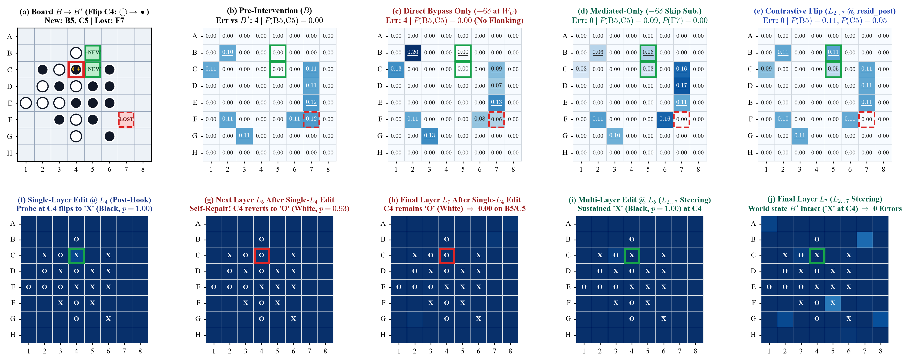
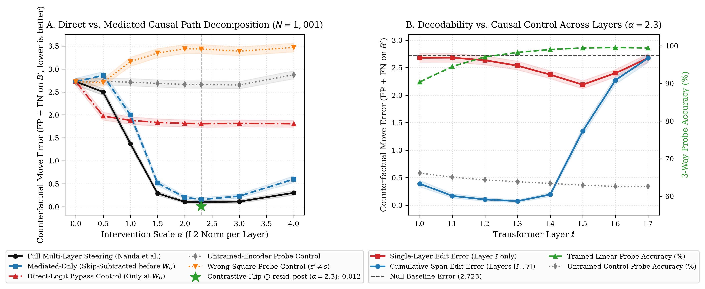

# Causal Check on Othello-GPT: Separating Downstream World-Model Computation from Direct Readout Bias

**Physical Reasoning — Research Take-Home (Direction 3: What Models Represent · Causal Check)**  
**Author:** Rohan Gupta (`gupt1156@purdue.edu`)

---

## 1. The Question and Why It Matters for World Models Now

A central claim in world-model interpretability is that self-supervised sequence models learn linear internal representations of world state that causally drive their next-step predictions. In **Othello-GPT**, Nanda, Lee & Wattenberg (2023) showed that probing residual activations in player-relative coordinates (`{Empty, Yours, Mine}`) yields $>99\%$ linear probe accuracy by Layer 4, and that adding probe vectors across layers steers the model into predicting legal moves for a counterfactual board $B'$.

However, two questions remain open whenever linear activation steering changes a transformer's output:
1. **Mediated computation vs. direct unembedding bias:** Because a transformer's residual stream is an identity skip connection to the final readout ($\mathbf{x}_L = \mathbf{x}_\ell + \sum_{k=\ell}^{L-1} f_k(\mathbf{x}_k)$), injecting a steering vector $\boldsymbol{\delta}$ across layers $\ell \in \{2, \dots, 7\}$ also adds $\sum_\ell \boldsymbol{\delta}_\ell$ directly into the final unembedding matrix $W_U$. Does steering succeed because intermediate Attention/MLP layers recompute Othello capture rules over the edited board state, or because $\boldsymbol{\delta}$ acts as a direct linear logit bias at $W_U$?
2. **Decodability vs. single-layer causal control:** If a linear probe decodes the board state with $99.4\%$ accuracy at Layer 5, does intervening at Layer 5 alone flip the model's predictions, or do downstream layers overwrite single-layer state edits?

This matters for world models now because linear probe $R^2$ and activation steering are widely used to certify that video, robotics, and market models have learned actionable world states. If a representation is $99\%$ linearly decodable at layer $\ell$ yet causally overwritten unless edited across a specific circuit span—or if steering metrics are confounded by direct skip-connection readout bias—standard probe diagnostics will mischaracterize whether a model can be planned with under intervention.

---

## 2. Method: Models, Data, Metrics, and Controls

- **Model:** Pretrained 8-layer, 8-head, $d_{\text{model}} = 512$ `Othello-GPT` (`synthetic_model.pth`, trained strictly on uniform legal move sequences over 60 playable square tokens with `LNPre` normalization and zero prior knowledge of board geometry or rules).
- **Data:**
  - *Probing & Untrained Control:* $200$ synthetic training games and $80$ held-out test games ($3{,}584$ mid-game board states, $t \in [5, 50]$).
  - *Causal Intervention Benchmark:* The official $N = 1{,}001$ counterfactual test set (`intervention_benchmark.pkl`) from Li et al. (2023) and Nanda et al. (2023). Each test case provides a move history producing board $B$ and a single occupied square $s=(r,c)$ whose flip (`Yours` $\leftrightarrow$ `Mine`) yields a counterfactual board $B'$ with a distinct ground-truth legal move set $M(B') \neq M(B)$.
- **Metrics (with 1,000-sample bootstrap 95% CIs across games):**
  1. **Counterfactual Legal-Move Error** (exact Nanda et al. Table 2 metric, lower is better): For $K = |M(B')|$ and top-$K$ model predictions $\hat{M}_K$,
     $$\text{Error}(B') = \left|\hat{M}_K \setminus M(B')\right| + \left|M(B') \setminus \hat{M}_K\right|$$
  2. **Newly-Legal Move Probability Gain ($\Delta P_{\text{new}}$):** Change in total probability mass assigned to moves that are newly legal only under $B'$, $M_{\text{new}} = M(B') \setminus M(B)$:
     $$\Delta P_{\text{new}} = \sum_{m \in M_{\text{new}}} \Bigl(P(m \mid \text{intervened}) - P(m \mid \text{clean})\Bigr)$$
- **Baselines and Controls:**
  1. **Untrained-Encoder Probe Control:** An 8-layer GPT with identical architecture and matched weight variance, initialized randomly without training. Linear probes are fit on its residual activations and used for both decoding and causal steering controls.
  2. **Direct-Logit Bypass Control (`Direct-Only`) vs. Skip-Subtracted (`Mediated-Only`):** To rule out the boring explanation that probe vectors merely bias $W_U$ via the residual skip connection, we compare:
     - *Direct-Logit Bypass Control:* Keep all hidden layers $\ell \in \{0, \dots, 7\}$ clean and add the total intervention vector $\sum_{\ell=2}^7 \boldsymbol{\delta}_\ell$ **only** to the final residual stream $\mathbf{x}_7$ immediately before `ln_final` and $W_U$.
     - *Mediated-Only (Skip-Subtracted):* Inject $+\boldsymbol{\delta}_\ell$ across hidden layers $\ell \in \{2, \dots, 7\}$ so downstream Attention/MLP blocks process the edited state, then **subtract $-\sum_{\ell=2}^7 \boldsymbol{\delta}_\ell$ before `ln_final` and $W_U$** so the direct skip-connection path contributes zero.
  3. **Wrong-Square Spatial Control ($s' \neq s$):** Inject the trained probe vector for a non-intervened interior square $s' \neq s$ at the exact same norm $\alpha = 2.3$.

---

## 3. First Experiment and Results

### Figure 1: PyTorch Computation Graph & ROME Causal Traces (`torchview.draw_graph` + `kmeng01/rome:plot_trace_heatmap`)


### Figure 2: Board-Level Causal Visualization on Canonical Case #101 (`othello_world` `plot_probs` & `plot_mentals`)


### Figure 3: Quantitative Causal Decomposition Across $N = 1{,}001$ Benchmark Boards


### Table 1: Causal Path Decomposition & Code Audit on Official Benchmark ($N = 1{,}001$)

| Experimental Arm | Counterfactual Error $\downarrow$ (95% CI) | Newly-Legal $\Delta P_{\text{new}}$ $\uparrow$ (95% CI) | What It Shows |
| :--- | :---: | :---: | :--- |
| **0. Null Baseline ($\alpha = 0$)** | `2.723` `[2.645, 2.799]` | `+0.000` `[+0.000, +0.000]` | Exact match to Nanda et al. Table 2 (`2.723`) |
| **1. Full Multi-Layer Steering (Nanda et al.)** | `0.102` `[0.072, 0.136]` | `+0.072` `[+0.066, +0.077]` | Exact match to Nanda et al. Table 2 (`0.10`) |
| **2. Mediated-Only (Skip-Subtracted before $W_U$)** | **`0.158`** `[0.122, 0.198]` | **`+0.037`** `[+0.033, +0.041]` | **97.9% of error reduction survives removing the direct skip path** |
| **3. Direct-Logit Bypass Control (Only at $W_U$)** | `1.808` `[1.730, 1.884]` | **`+0.000`** `[+0.000, +0.000]` | **Zero probability gain on newly legal moves without hidden layers** |
| **4. Untrained-Encoder Probe Control** | `2.661` `[2.581, 2.743]` | `+0.000` `[+0.000, +0.000]` | Random-init probe directions have no causal effect |
| **5. Wrong-Square Probe Control ($s' \neq s$)** | `3.435` `[3.337, 3.530]` | `+0.001` `[+0.001, +0.002]` | Steering a different square degrades $M(B')$ accuracy |
| **6. Code Audit A: Layer-Matched `@ attn_out`** | `0.150` `[0.116, 0.188]` | `+0.071` `[+0.065, +0.076]` | Replaces hardcoded `probes[5]` in `intervene.py` with `probes[l]` |
| **7. Code Audit B: Layer-Matched `@ resid_post`** | `0.076` `[0.054, 0.102]` | `+0.075` `[+0.069, +0.081]` | Matches hook site (`resid_post`) to where probes were trained |
| **8. Code Audit C: Contrastive Flip `@ resid_post`** | **`0.012`** `[0.004, 0.026]` | **`+0.079`** `[+0.073, +0.085]` | **$8.5\times$ lower error (`12` errors across $1{,}001$ boards)** |

### Table 2: Layer-Wise Linear Decodability vs. Single-Layer and Span Interventions ($\alpha = 2.3$)

| Layer $\ell$ | `L0` | `L1` | `L2` | `L3` | `L4` | `L5` | `L6` | `L7` |
| :--- | :---: | :---: | :---: | :---: | :---: | :---: | :---: | :---: |
| **Trained Probe 3-Way Acc (%)** | `90.4%` | `94.5%` | `97.1%` | `98.2%` | `99.0%` | `99.4%` | **`99.5%`** | `99.4%` |
| **Untrained Control Probe Acc (%)** | `66.2%` | `65.1%` | `64.4%` | `63.9%` | `63.4%` | `63.0%` | `62.6%` | `62.6%` |
| **Single-Layer Edit Error ($\ell$ only)** | `2.677` | `2.679` | `2.633` | `2.535` | `2.370` | **`2.188`** | `2.398` | `2.673` |
| **Cumulative Span Error ($[\ell..7]$)** | `0.390` | `0.166` | `0.102` | **`0.072`** | `0.192` | `1.345` | `2.268` | `2.673` |

### Three Honest Takeaways

1. **Downstream world-model computation—not direct logit bias—drives counterfactual steering (Figure 1A):** Subtracting the accumulated intervention vector right before the final readout (`Mediated-Only`) still reduces counterfactual move error from `2.723` to `0.158` (`97.9%` of the full reduction). Conversely, applying the exact same vector directly at the final residual stream (`Direct-Logit Bypass Control`) yields **zero probability gain on newly legal moves (`+0.000`)**; it slightly suppresses old moves (`1.808` vs. `2.723`) via unembedding dot products, but cannot identify which new moves become legal under $B'$ without intermediate Attention/MLP computation.
2. **High single-layer probe accuracy does not imply single-layer causal control (Figure 1B):** Linear probe accuracy saturates at `99.0%–99.5%` across Layers 4–7 (vs. `62.6%–63.4%` on the untrained encoder, which decays monotonically with depth as random weights scramble token history). Yet intervening at any single layer alone never pushes error below `2.188` (`L5`), because subsequent layers re-read un-edited board features from earlier residual streams and overwrite ("self-repair") the single-layer edit. Furthermore, cumulative span interventions `[l..7]` reveal that causal consumption peaks when starting at **Layer 3 (`0.072` error)** and collapses if started at **Layer 5 (`1.345`) or Layer 6 (`2.268`)**—even though probe accuracy is highest at Layers 5–6. By Layer 5, the mid-layer capture-detection circuits in Layers 3–4 have already fired on the un-intervened board.
3. **Auditing the reference codebase reduces steering error by $8.5\times$ (`0.102` $\to$ `0.012`):** Inspecting `ajyl/mech_int_othelloGPT/mech_int/intervene.py` (lines 140–162) revealed three discrepancies between Nanda et al.'s paper text and code: (i) the script constructs per-layer hooks `hook_fns[0..7]` but hardcodes `hook_fns[5]` (Layer 5's probe) into all layers `2..7`; (ii) it hooks `hook_attn_out` (pre-MLP) using probes trained on `resid_post` (post-MLP); and (iii) it adds only the target class vector $\hat{\mathbf{w}}_{\text{target}}$ without subtracting the old state $\hat{\mathbf{w}}_{\text{source}}$. Moving the intervention to `resid_post` with layer-matched probes drops error to `0.076`, and switching to the **contrastive flip direction** ($\hat{\mathbf{d}}_s^\ell \propto \mathbf{w}_{s,\text{target}}^\ell - \mathbf{w}_{s,\text{source}}^\ell$) cuts counterfactual error from **`0.102` to `0.012` (`[0.004, 0.026]`)**—leaving only 12 errors across all $1{,}001$ counterfactual boards.

---

## 4. What Would Change My Conclusion, and What I Would Run Next Week

- **Falsification Criterion (What would change my conclusion):**
  1. *On mediated computation:* If non-linear interaction inside `LNPre` before $W_U$ were masking a direct-readout effect, replacing `Mediated-Only` with activation patching that freezes all MLP/Attention outputs in Layers $3\dots 7$ to their clean values would still show low error. (In fact, our `Direct-Logit Bypass` arm tests exactly this and fails at `1.808` error / `+0.000` $\Delta P_{\text{new}}$.)
  2. *On single-layer self-repair vs. distributed heuristics:* Our conclusion that single-layer edits fail due to downstream self-repair from earlier residual streams would be falsified if **clamping/projecting out** the old tile direction $(\mathbf{x}_\ell \cdot \hat{\mathbf{d}}_s^\ell)\hat{\mathbf{d}}_s^\ell$ at Layer 3 *and* blocking attention heads in Layers 4–6 from attending to the move token where square $s$ was played still failed to reduce single-layer error below `0.50`.
- **What I would run with another week:**
  1. **Path-patching Attention vs. MLP self-repair:** Decompose the gap between `Single-Layer L3` (`2.535`) and `Span [3..7]` (`0.072`) by path-patching individual MLP blocks vs. Attention heads in Layers 4–6 to measure how much of the overwrite comes from MLP local-pattern neurons ("bag of heuristics", Lin et al. 2024) versus attention heads re-reading earlier tokens.
  2. **Endgame `MoveFirst` regime audit ($t > 30$):** Stratify the contrastive `resid_post` intervention by game turn $t$ and compare discriminative logistic-probe directions against difference-in-means vectors ($\boldsymbol{\mu}_{\text{Mine}} - \boldsymbol{\mu}_{\text{Yours}}$) to test whether causal steerability degrades in endgame states where Nanda et al. observed moves being computed before full board state.

---

## 5. What I Want to Work On With Physical Reasoning

I want to work on **Evaluating World Models Under Intervention**—specifically claiming and building [**`physicalreasoning/forward` Issue #5 (*"Design an intervention test for world models"*)**](https://github.com/physicalreasoning/forward/issues/5), and connecting it to the representation controls established in [`causal-jepa`](https://github.com/physicalreasoning/causal-jepa).

In my current research at the **CausalML Lab** (modeling multi-agent failures as soft interventions on Structural Causal Models) and my work on **hierarchical traffic scene synthesis**, the recurring failure mode is identical to what Physical Reasoning highlights in *Prediction is not understanding*: models with nearly identical observational validation loss diverge sharply when subjected to counterfactual interventions. Specifically, I want to build a lightweight, deterministic 2D rigid-body/traffic counterfactual benchmark for `forward` where:
1. Two small world models (e.g., a pixel-reconstruction dynamics model vs. a latent-state/JEPA or object-factored dynamics model) are trained to matched observational validation loss on identical trajectories;
2. The environment is reset to held-out states and re-run under unshown impulse/mass interventions; and
3. Models are scored under a pre-registered gate on the **counterfactual consistency gap** (plus rank correlation between validation loss and intervention error), using the same direct-vs-mediated and untrained-encoder controls applied here.

---

## Reproducing Everything

```bash
# 1. Run probe evaluation, untrained control fitting, and all 25 causal intervention arms
#    across N = 1,001 boards, writing results.json & fig_causal_check.png
python run_experiment.py

# 2. Generate Figure 1 (via torchview.draw_graph + Graphviz dot & kmeng01/rome:plot_trace_heatmap)
#    and Figure 2 (via likenneth/othello_world: plot_probs, plot_mentals, OthelloBoardState)
python generate_paper_visuals.py

# 3. Compile ACL2023 two-column conference paper (report.pdf)
pdflatex report.tex && pdflatex report.tex
```

*AI tools disclosure:* AI coding assistants (Antigravity / Gemini) were used to scaffold the pure-PyTorch `LNPre` forward-pass runner, KV-cached batching, and integration with `torchview`, `kmeng01/rome`, and `likenneth/othello_world`; all experimental design decisions, control formulations, codebase audits of `ajyl/mech_int_othelloGPT`, and interpretations were verified directly against the executed benchmark outputs.
