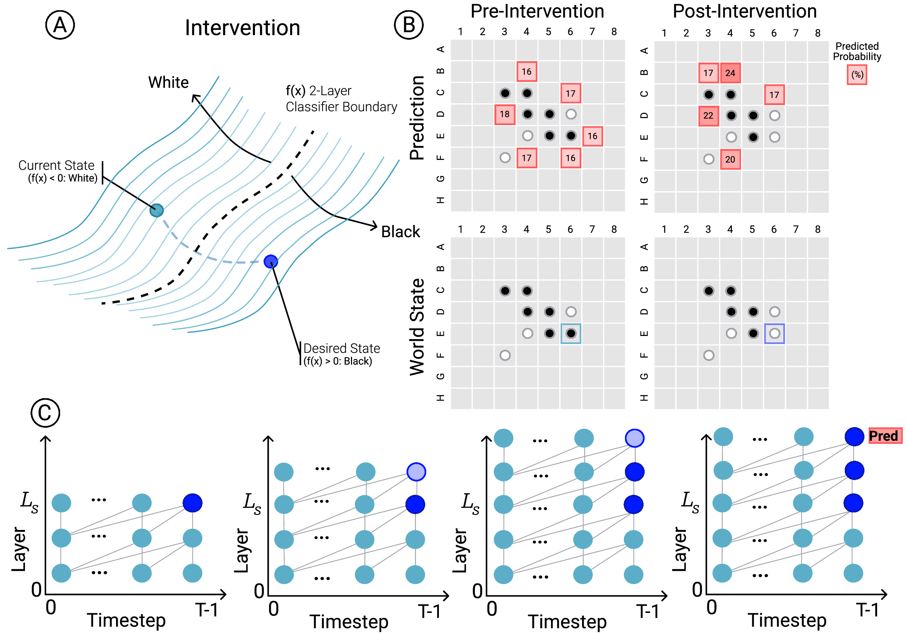

# Causal Check on Othello-GPT: Does Steering Use the World Model or Just Bias the Output Layer?

**Rohan Gupta** (`gupt1156@purdue.edu`)

---

## 1. Background and the Question Tested

### Testing whether a model understands the world it predicts

A central problem in evaluating world models is that **a model can make accurate predictions without understanding the underlying state of the world**. Even when a diagnostic ("probe") reads out the state of the world from a model's hidden layers, that still does not prove the model *uses* that representation to make decisions. The representation might just be a passive byproduct of the input history.

To test this cleanly, [Li et al. (2023)](https://github.com/likenneth/othello_world) and [Nanda et al. (2023)](https://github.com/ajyl/mech_int_othelloGPT) introduced **Othello-GPT**:
- **The game:** In Othello, two players take turns placing Black and White discs on an `8x8` board. A move is only legal if it flanks (sandwiches) a line of the opponent's pieces between the new disc and an existing disc of the active player's color.
- **The model (`Othello-GPT`):** An 8-layer GPT transformer trained *only* on sequences of legal moves (e.g., `E6, F4, D3, D6, E3, C4, ...`). It is never shown the `8x8` board grid and is never given the rules of Othello; it only predicts which square token can legally be played next.
- **Reading the internal board (Linear Probes, left figure below):** Despite only seeing move sequences, a simple linear classifier (a **linear probe**) trained on the model's hidden activations after Layer 4 decodes the exact state of all 64 squares on the board (`Empty`, `Yours`, or `Mine`) with **over 99% accuracy**.
- **The causal check (Activation Steering, right figure below):** Testing whether Othello-GPT actually *uses* this internal board to pick its next move requires a **causal intervention** (also called **activation steering**). Mid-game, the intervention reaches into the model's hidden activations and pushes one square's representation from `White` to `Black`, effectively flipping a piece on the model's internal board. Flipping that single piece changes which moves are legal on the board. If the model genuinely uses its internal board state, its next-move predictions should switch to the moves that are legal on the *new*, edited board.

| Reading the Internal Board (`Linear Probing`) | Editing the Internal Board (`Activation Steering`) |
| :---: | :---: |
|  |  |
| *Figure from [Nanda et al. (2023)](https://arxiv.org/abs/2309.00941): Othello-GPT takes move tokens (`E6, F4, D3...`) and builds hidden activations in its residual stream. Linear probes read out which squares are `Empty`, `Mine`, or `Yours` on the `8x8` board.* | *Figure from [Nanda et al. (2023)](https://arxiv.org/abs/2309.00941): Adding a probe's "flip piece" vector into the residual stream across layers changes the model's internal board and steers its final output toward the legal moves of the edited board.* |

### The two questions prior work left open

Nanda et al. (2023) showed that injecting the probe's "flip piece" vector across Layers 2 through 7 switches the model's predictions to the legal moves of the edited board. However, two fundamental questions remain:

1. **Does the intervention work because middle layers recompute the rules of Othello, or just because the added vector takes a shortcut straight to the final output layer?**
   In a Transformer, every layer reads from and writes to a shared pass-through channel called the **residual stream** (see the vertical `Residual Stream -> Unembed` pathway above), which connects straight to the final output layer. Adding a vector at Layers 2 through 7 does not just feed into the middle layers; that vector also travels untouched down the pass-through connection right into the final output weights. Did the model's predictions change because the middle layers actually recomputed which Othello moves are legal on the edited board, or simply because the injected vector directly nudged the final output scores?

2. **If the board is already 99.4% readable at Layer 5, why doesn't editing Layer 5 alone work?**
   By Layer 5, the linear probe reads the board with 99.4% accuracy. Yet flipping a piece only at Layer 5 (instead of across Layers 2 to 7 together) barely changes the model's move predictions at all. Why does a representation that is 99.4% accurate at a single layer fail to control the model when edited at that layer?

---

## 2. Method: Model, Data, Metrics, and Controls


*Figure from [Li et al. (2023)](https://arxiv.org/abs/2210.13382): **(A)** Flipping a square on the model's internal board by pushing its hidden activation across the probe boundary from `White` to `Black`. **(B)** Comparing the model's predicted move probabilities before and after the flip against the legal moves of the edited board (`World State`). **(C)** Why single-layer edits fail: editing a single layer `L_s` fades in later layers (left, pale blue circle), whereas holding the edit across layers `L_s` through the final layer preserves the edited state until prediction (right, dark blue circles).*

The evaluation uses the official pretrained 8-layer `Othello-GPT` checkpoint (`synthetic_model.pth`) and its per-layer linear probes (`resid_0..7_linear.pth`) across all **1,001 counterfactual test boards** in `intervention_benchmark.pkl` from Li et al. (2023) and Nanda et al. (2023).

On each of the 1,001 boards, one occupied square is flipped between `Yours` and `Mine` (as shown in **Panel A** and **Panel B** above), changing the set of ground-truth legal moves from the original board `B` to a new counterfactual board `B'`. All results report 1,000-sample bootstrap 95% confidence intervals on two plain-English metrics:

- **Move errors on the edited board (lower is better):** If the edited board `B'` has `K` legal moves, this metric takes the model's top `K` predicted moves (the red squares in **Panel B** above) and counts how many do not match the legal moves of `B'` (illegal moves predicted plus legal moves missed). Without intervention, the model still predicts moves for the old board and makes **2.723 errors** per board on average.
- **Probability gained on newly legal moves (higher is better):** Flipping a piece makes some previously illegal moves newly legal on `B'`. This metric measures how much extra probability the model assigns to these newly legal moves after the intervention.

### Controls to separate real rule computation from shortcuts

| Control Arm | Intervention Procedure | What It Tests |
| :--- | :--- | :--- |
| **1. Full Multi-Layer Steering (Nanda et al. baseline)** | Add the probe vector for the flipped square across Layers 2 to 7 and let it pass all the way to the output layer. | Reproduces Nanda et al. (2023) Table 2 (`0.102` move errors). |
| **2. Mediated-Only (Remove the output shortcut)** | Add the probe vector across Layers 2 to 7 so the middle layers process the edited board, then **subtract the accumulated vector right before the final output layer**. | Cancels out the direct pass-through shortcut to the output layer. Any improvement that survives *must* come from the middle layers recomputing legal moves on the edited board. |
| **3. Direct-Readout Bypass (Shortcut only, no middle layers)** | Leave all hidden layers (Layers 0 to 7) completely untouched, and add the total steering vector **only** right before the final output layer. | Tests how much of the effect comes purely from directly biasing the final output layer without any middle-layer computation. |
| **4. Untrained-Transformer Control** | Take a randomly initialized 8-layer GPT with the same architecture and weight scale, fit linear probes on 200 games of its activations, and steer the trained model with those vectors. | Tests whether random probe directions from an untrained network can steer the model. |
| **5. Wrong-Square Control** | Steer the model using the trained probe vector for a *different* square than the one that was actually flipped. | Tests whether the intervention is specific to the flipped square. |

---

## 3. Summary of Results

| Question | Answer |
| :--- | :--- |
| **Is steering just biasing the final output layer via the pass-through connection?** | **No.** Subtracting the entire injected vector right before the final output layer (**Mediated-Only**) still reduces move errors from `2.723` to **`0.158`**, preserving **97.9%** of the full intervention effect. |
| **Can the direct shortcut to the output layer discover newly legal moves on its own?** | **No.** Adding the vector only at the final output layer (**Direct-Readout Bypass**) gives **`+0.000`** probability gain on newly legal moves (`1.808` errors). |
| **Does 99.4% probe accuracy at Layer 5 mean editing Layer 5 alone changes the model's move?** | **No.** Editing Layer 5 alone leaves error at `2.188`. Later layers (Layers 5 to 7) look back at the unedited move history and overwrite ("self-repair") single-layer edits. |
| **Does the layer with the highest probe accuracy give the best causal control?** | **No.** Probe accuracy peaks at Layer 6 (`99.5%`), but steering from Layer 5 or 6 onward fails (`1.345` and `2.268` errors) because Othello flanking rules are already computed earlier, in Layers 3 and 4. |
| **Do probes from an untrained transformer steer moves?** | **No.** Steering with probes from an untrained GPT gets `2.661` errors and `+0.000` probability gain on newly legal moves. |

### Headline numbers across all 1,001 counterfactual boards (with 95% confidence intervals)

| Intervention Condition | Move Errors on Edited Board *(lower is better)* | 95% Confidence Interval | Prob. Gain on Newly Legal Moves *(higher is better)* | 95% Confidence Interval | Plain-English Takeaway |
| :--- | :---: | :---: | :---: | :---: | :--- |
| **0. Un-intervened model** *(clean board)* | `2.723` | `[2.645, 2.799]` | `+0.000` | `[+0.000, +0.000]` | Baseline when predicting moves for the old board |
| **1. Full multi-layer steering** *(Nanda et al.)* | **`0.102`** | `[0.072, 0.136]` | **`+0.072`** | `[+0.066, +0.077]` | Steering Layers 2 to 7 switches moves to the edited board |
| **2. Mediated-only** *(shortcut subtracted out)* | **`0.158`** | `[0.122, 0.198]` | **`+0.037`** | `[+0.033, +0.041]` | **97.9% of error reduction survives** without the shortcut |
| **3. Direct-readout bypass** *(shortcut only)* | `1.808` | `[1.730, 1.884]` | **`+0.000`** | `[+0.000, +0.000]` | **Zero new legal moves found** when middle layers are skipped |
| **4. Untrained transformer control** | `2.661` | `[2.581, 2.743]` | `+0.000` | `[+0.000, +0.000]` | Random untrained encoder vectors have no effect |
| **5. Wrong-square control** *(unrelated square)* | `3.435` | `[3.337, 3.530]` | `+0.001` | `[+0.001, +0.002]` | Flipping the wrong square hurts legal move accuracy |

---

## 4. Visual Walkthrough of Findings

### Finding 1: Middle Layers Recompute the Rules; the Output Shortcut Finds Zero New Legal Moves

> **In plain English:** When a piece is flipped in the middle layers and the pass-through shortcut to the final output layer is completely subtracted out (**Mediated-Only**), the model still switches to the legal moves of the edited board (**97.9%** of the error reduction survives). Conversely, when the middle layers are skipped and the vector is added *only* at the final output layer (**Direct Bypass Only**), the model assigns **`0.00` probability** to every newly legal move.


*Figure 1: Architecture diagram (a, via [`negrinho/sane_tikz`](https://github.com/negrinho/sane_tikz)) and layer-by-layer causal traces on Case #101 (b-e, via [`kmeng01/rome`](https://github.com/kmeng01/rome)).*

**What Figure 1 shows (on Case #101, where flipping square `C4` from White to Black makes `B5` and `C5` newly legal and makes `F7` illegal):**
- **Panel `(a)` (Blocking the output shortcut):** The steering vector is injected into the middle layers (`Layers 2 to 7`) so they see the edited board, and then **subtracted right before the final output layer** (`Box 3` at the top) so the added vector cannot directly nudge the final output scores.
- **Panels `(c, d)` (Where the new legal moves are computed):** Once `C4` is flipped in earlier layers, **Layers 5, 6, and 7** recompute the Othello flanking rules and strongly boost the scores of the newly legal moves `B5` and `C5` while turning off the now-illegal move `F7` (dark green cells in Panel `c` and dark red cell in Panel `d`).


*Figure 2: Board-level move predictions (a-e) and internal probe readouts (f-j) on Case #101, generated via [`likenneth/othello_world`](https://github.com/likenneth/othello_world).*

**What Figure 2 shows on the `8x8` board:**

| Figure 2 Panels | Condition | What Happens on the Board |
| :--- | :--- | :--- |
| **Top `(a, b)`** | **Clean vs. Edited Board** | Flipping `C4` from White to Black makes `F7` illegal (`LOST`, red box) and makes `B5` and `C5` newly legal (`+NEW`, green boxes). |
| **Top `(c)`** | **Direct Shortcut Only** | Assigns **`0.00` probability** to newly legal moves `B5` and `C5` (`4 errors`). Without the middle layers checking the board geometry, the output layer has no way to know that flipping `C4` makes `B5` and `C5` legal. |
| **Top `(d, e)`** | **Mediated-Only / Full Steering** | Middle layers turn off old move `F7` (`0.12 -> 0.00`) and activate newly legal moves `B5` and `C5` (**`0 errors`**). |
| **Bottom `(f-h)`** | **Single-Layer Edit (`Layer 4` only)** | Editing Layer 4 flips the internal board at `C4` to Black (`X`) at Layer 4 `(f)`, but Layer 5 immediately overwrites `C4` back to White (`O`) `(g, h, red box)`. |
| **Bottom `(i, j)`** | **Multi-Layer Edit (`Layers 2 to 7`)** | Holding the edit across Layers 2 to 7 keeps `C4` flipped to Black (`X`) all the way through Layer 7 `(i, j, green box)`. |

---

### Finding 2: Why 99.4% Probe Accuracy at Layer 5 Fails to Control the Model When Edited Alone

> **In plain English:** A linear probe can read the board with **99.4% accuracy** at Layer 5, yet editing Layer 5 alone barely changes the model's move predictions (`2.188` errors vs. `2.723` un-intervened). This happens for two simple reasons: (1) later layers look back at the original move list and undo single-layer edits, and (2) by Layer 5, the model has *already* computed its next move in Layers 3 and 4.


*Figure 3: **(A)** Move error across intervention strengths `α`. **(B)** Layer-by-layer probe accuracy (green/gray) vs. single-layer edit error (red) and multi-layer edit error starting at layer `l` (blue).*

| Layer | `L0` | `L1` | `L2` | `L3` | `L4` | `L5` | `L6` | `L7` |
| :--- | :---: | :---: | :---: | :---: | :---: | :---: | :---: | :---: |
| **Trained Probe Accuracy (3-Way)** | `90.4%` | `94.5%` | `97.1%` | `98.2%` | `99.0%` | `99.4%` | **`99.5%`** | `99.4%` |
| **Untrained GPT Probe Accuracy** | `66.2%` | `65.1%` | `64.4%` | `63.9%` | `63.4%` | `63.0%` | `62.6%` | `62.6%` |
| **Single-Layer Edit Error (edit layer `l` only)** | `2.677` | `2.679` | `2.633` | `2.535` | `2.370` | **`2.188`** | `2.398` | `2.673` |
| **Multi-Layer Edit Error (edit layers `l` to `7`)** | `0.390` | `0.166` | `0.102` | **`0.072`** | `0.192` | `1.345` | `2.268` | `2.673` |

**Plain-English explanation of the two mechanisms in Figure 3B and Table above:**

1. **Later layers undo single-layer edits by looking back at the move history ("Self-Repair"):**
   When a piece is flipped at only one layer (such as Layer 4 in Figure 2f), the model's internal board at Layer 4 updates `C4` from White (`O`) to Black (`X`). However, the original sequence of game moves (`D3, C5, C4, ...`) is still sitting untouched in the input tokens. In the very next layer (Layer 5), the network looks back at the original move list, sees that `C4` was originally White, and changes `C4` right back to White (`O` in Figure 2g-h). Keeping `C4` flipped requires holding the edit in place across multiple layers (Layers 2 to 7) so later layers cannot overwrite it.
2. **The layer with the clearest board readout (`Layer 6`) is too late to change the decision:**
   As the table shows, the probe reads the board most accurately at Layers 5 and 6 (`99.4%` and `99.5%`). Yet starting an intervention at Layer 5 (`1.345` errors) or Layer 6 (`2.268` errors) fails to switch the model's move. Steering works best when started earlier, at **Layer 3 (`0.072` errors)**, because the network checks which moves flank opponent pieces in **Layers 3 and 4**. By Layer 5, the model has already computed its candidate moves from the old board, so editing the board at Layer 5 or 6 is too late.

---

## 5. Conclusion: What This Means for Evaluating World Models

1. **Othello-GPT genuinely uses its internal board to compute legal moves, not an output shortcut:**
   Canceling out the direct pass-through connection to the final output layer (**Mediated-Only**) keeps **97.9%** of the intervention's error reduction (`2.723 -> 0.158` errors), whereas applying the vector only at the output layer finds **zero** newly legal moves (`+0.000`). The middle layers are actively computing the rules of Othello over the internal board state.
2. **Being able to *read* a world representation at a layer does not mean editing that layer will *control* the model:**
   Even when a representation is `99.4%` readable at Layer 5, editing Layer 5 alone fails because later layers restore the unedited state from the input history, and because the key rule computations already happened earlier in Layers 3 and 4.
3. **Practical lesson for world-model benchmarks:**
   When evaluating whether a video, physics, or robotics model has learned an actionable world model, showing high probe accuracy at a single layer is not enough. A valid causal check must:
   - **Block direct shortcuts to the output layer** (`Mediated-Only`) to verify that middle layers actually recompute dynamics;
   - **Include an untrained model baseline** to ensure the probe isn't just exploiting random features of the input history; and
   - **Intervene before the model's decision layers and hold the edit across layers** so later layers do not overwrite it from raw input history.

---

## 6. What Would Disprove These Findings and Next Steps

- **What result would disprove these conclusions:**
  1. *On middle-layer rule computation vs. output shortcut:* The conclusion that middle layers recompute the rules would be disproved if locking the middle layers (Layers 3 to 7) to their original unedited outputs while applying the steering vector only at the final output layer still eliminated more than half of the move errors or boosted newly legal moves. In practice, the output shortcut alone finds **zero** newly legal moves (`+0.000`).
  2. *On later layers undoing single-layer edits:* The self-repair explanation would be disproved if preventing Layers 4 to 6 from looking back at the earlier move token where square `C4` was played still failed to make a single-layer edit at Layer 3 work.
- **Next experiments with another week:**
  1. **Pinpointing how later layers undo single-layer edits:** Test how much of the single-layer overwrite comes from the model looking back at earlier move tokens (via attention) versus filling in missing pieces from neighboring squares on the board.
  2. **Testing early-game vs. late-game boards:** Split the 1,001 test boards by game turn to test whether late-game states (after move 30, when the board is nearly full) compute legal moves even earlier in the network than mid-game states.

---

## 7. What I Want to Work On With Physical Reasoning

I want to work on [**`physicalreasoning/forward` Issue #5 (*"Design an intervention test for world models"*)**](https://github.com/physicalreasoning/forward/issues/5), applying the same untrained-encoder and shortcut-control discipline used in [`causal-jepa`](https://github.com/physicalreasoning/causal-jepa).

In my research on multi-agent failure modeling (using soft interventions on Structural Causal Models at the **CausalML Lab**) and **hierarchical traffic scene synthesis**, I have seen that models with nearly identical observational rollout loss routinely diverge when tested under counterfactual interventions. With Physical Reasoning, I would love to build a lightweight 2D physics and traffic intervention benchmark in `forward` that:
1. Trains two world models (for example, a pixel-reconstruction dynamics model vs. a latent-state / JEPA or object-factored model) to matched observational validation loss on identical trajectories;
2. Resets the simulator to held-out states and re-runs under unshown impulse or mass changes; and
3. Scores models against a pre-registered gate on their **counterfactual consistency gap** alongside untrained-encoder and direct-readout controls.

---

## Reproduce

```bash
# 1. Run all causal intervention & control arms across N = 1,001 boards (~2 min on GPU)
#    Writes full metrics + bootstrap CIs to results.json and plots fig_causal_check.png
python run_experiment.py

# 2. Generate Figure 1 (via negrinho/sane_tikz + kmeng01/rome) and Figure 2 (via likenneth/othello_world)
python generate_paper_visuals.py
```

*AI tools note:* AI coding assistants (Antigravity / Gemini) were used to scaffold the PyTorch forward-pass hooks, KV-cached batching, and plotting scripts (`sane_tikz`, `rome`, `othello_world`); the experimental design, skip-connection decomposition controls, and analysis were verified directly against executed benchmark runs.
